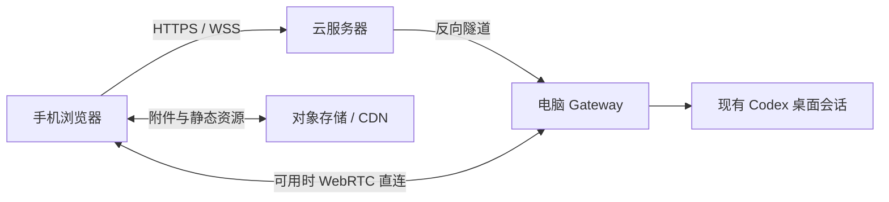

# Codex Pocket Remote

**离开电脑，也能在手机上继续使用 Codex。**

Codex Pocket Remote 是一个可自行部署的移动端网页客户端，连接电脑上正在运行的 Codex 桌面会话。你可以查看执行进度、发送指令、回答问题、处理审批，以及接收代码、图片和文件。手机与电脑使用同一条会话，可以随时切换。

目前支持 Linux 桌面主机与 Android Chrome。本项目为非官方项目，仍处于早期开发阶段。

## 界面预览

| 聊天与工具活动                                                                    | 回答问题                                                             |
| --------------------------------------------------------------------------------- | -------------------------------------------------------------------- |
|  |  |

## 主要功能

- **继续桌面会话**：按项目浏览、搜索会话、查看历史，实时接收电脑上的消息与执行进度。
- **控制任务**：发送消息、运行中追加指令、中断任务，或将消息排到下一轮。
- **调整工作方式**：选择模型、推理强度和速度，切换计划模式，使用本机已安装的技能与插件。
- **处理交互**：在手机上回答选择题和自由输入问题，查看并处理命令、文件变更审批。
- **阅读完整内容**：支持 Markdown、代码高亮、数学公式、Mermaid、Diff、图片、音频和视频；工具活动可折叠。
- **传递文件**：从手机上传图片与附件，打开会话中的文件，保留原文件内容。
- **灵活部署**：支持 HTTPS 云入口、WebRTC 直连、静态资源 CDN 与可选对象存储适配器。

## 开始使用

### 环境要求

| 组件     | 要求                                           |
| -------- | ---------------------------------------------- |
| 桌面主机 | Linux，运行并登录支持 Codex 的 ChatGPT Desktop |
| 运行环境 | Node.js 24+、Python 3                          |
| 手机     | Android Chrome                                 |
| 远程访问 | 可用的 HTTPS 域名与反向代理入口                |

当前兼容基线为 `chatgpt-bin 26.1029.61003-1`，内置 Codex `0.166.0-alpha.6`。其他桌面版本需要重新适配；未知版本下默认关闭控制功能。

### 1. 安装与配置

在运行 Codex 的电脑上执行：

```bash
git clone https://github.com/muxkin/Remote-Agent-Control.git
cd Remote-Agent-Control
npm ci
npm run configure
```

编辑生成的 `local/gateway.env`，设置手机访问地址：

```dotenv
POCKET_PORT=4317
POCKET_PUBLIC_ORIGIN=https://codex.example.com
```

将示例域名替换为自己的 HTTPS 地址，并按 [部署指南](docs/CLOUD_DEPLOYMENT.md) 配置反向代理与隧道。配置项说明见 [.env.example](.env.example)。

### 2. 启动服务

保持桌面应用运行，并打开一个 Codex 会话：

```bash
npm run build
npm start
```

服务监听 `127.0.0.1:4317`，由反向代理提供手机入口。只想在电脑本机体验时，可将 `POCKET_PUBLIC_ORIGIN` 设为 `http://127.0.0.1:4317`，启动后用浏览器打开该地址。

### 3. 手机扫码连接

在电脑另一个终端运行：

```bash
npm run pair -- --open
```

用手机相机扫描二维码，打开页面并点击“连接电脑”。配对码五分钟内一次有效；完成配对后，无需每次重新扫码。

## 在手机上操作

| 操作                 | 入口                           |
| -------------------- | ------------------------------ |
| 查找会话             | 列表中的“最近”“项目”与搜索框   |
| 上传图片或文件       | 输入框左下角 `＋`              |
| 计划模式、技能与插件 | “工具”菜单                     |
| 模型、推理强度与速度 | 输入框下方的模型名称           |
| 发送或追加指令       | 输入文字后点击发送按钮         |
| 排队下一轮           | 任务运行时，长按发送按钮       |
| 中断当前任务         | 清空输入框后，点击暂停按钮     |
| 回答问题             | 消息中的“回答”，填写后统一提交 |
| 查看队列与操作记录   | 右上角 `…`                     |

切换会话时会保留各自草稿。工具查看的图片随工具活动展开；关闭手机网页不会停止电脑上的任务。

更多操作说明见 [使用指南](docs/USAGE.md)。

## 连接与流量



基本部署通过 HTTPS/WSS 转发消息。配置 STUN 后，可在网络允许时建立 WebRTC 直连，传输实时事件与控制；直连不可用时自动回退。

默认由 Gateway 传输附件。接入符合接口约定的对象存储适配器后，手机可直接上传和读取私有附件，减少云服务器的文件转发流量；前端静态资源也可通过 CDN 分发。项目不内置存储厂商实现，适配器接入方式见 [存储扩展](docs/STORAGE_ADAPTER.md)。

- [云服务器、STUN 与对象存储配置](docs/CLOUD_DEPLOYMENT.md)
- [功能支持范围](docs/CAPABILITIES.md)
- [架构与协议说明](docs/ARCHITECTURE.md)

## 使用须知

- 电脑必须保持在线，桌面应用需要运行。未加载的历史会话可能只能只读查看。
- 桌面连接使用内部 IPC，桌面升级可能影响兼容性。
- 技能和插件选择面向本机已安装内容，尚不支持安装管理与全部插件专用界面。
- 部分原生卡片、历史内嵌媒体和权限请求仍在适配中。
- 出现“结果待确认”时，先核对桌面执行情况，避免重复提交。

## 开发

```bash
npm ci
npm test
npm run typecheck
npm run build
```

前端使用 React、Vite 和 TypeScript；服务端使用 Fastify、WebSocket 与 SQLite。浏览器测试还需 Chrome 和 ffmpeg。开发与测试说明见 [贡献指南](CONTRIBUTING.md)。

## 许可证

[MIT](LICENSE)
