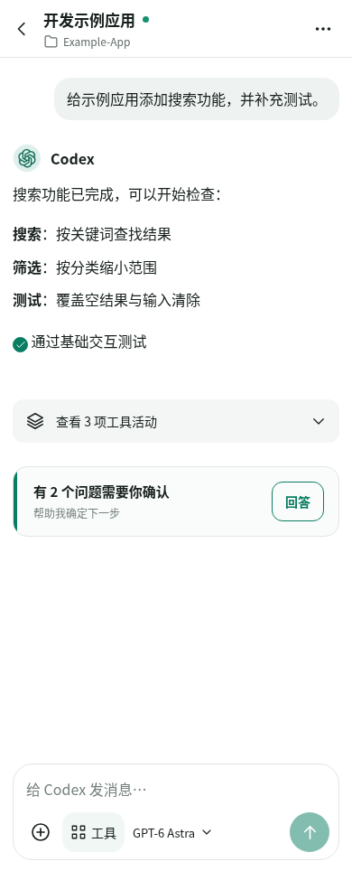
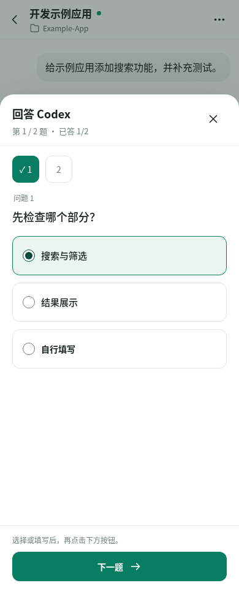
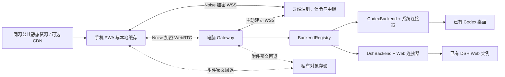

# Codex Pocket Remote

**离开电脑，也能在手机上继续使用已有的 Codex 与 DSH 会话。**

Codex Pocket Remote 是一个可自行部署的移动端网页客户端，连接电脑上正在运行的 Codex 桌面会话。你可以查看执行进度、发送指令、回答问题、处理审批，以及接收代码、图片和文件。手机与电脑使用同一条会话，可以随时切换。

已抽取通用后端，新增已有 DSH Web 实例接入和多实例工作台；macOS / Windows 连接基础及 DSH 适配标为实验性，手机采用浏览器/PWA。配置、能力限制和实际验证边界见 [通用后端与兼容矩阵](docs/BACKENDS.md)。v2 已通过 Linux Chrome 移动视口测试；Android/iOS 真机验收进度见 [验证记录](docs/VALIDATION_V2.md)。本项目为非官方项目，仍处于早期开发阶段。

## 界面预览

| 聊天与工具活动                                                                    | 回答问题                                                             |
| --------------------------------------------------------------------------------- | -------------------------------------------------------------------- |
|  |  |

## 主要功能

- **继续桌面会话**：按项目浏览、搜索会话、查看历史，实时接收电脑上的消息与执行进度。
- **控制任务**：发送消息、运行中追加文字与附件、中断任务，或将文字消息排到下一轮。
- **调整工作方式**：选择模型、推理强度和速度，切换计划模式，使用本机已安装的技能与插件。
- **处理交互**：在手机上回答选择题和自由输入问题，查看并处理命令、文件变更审批，以及批准计划或提出修改。
- **阅读完整内容**：支持 Markdown、代码高亮、数学公式、Mermaid、Diff、图片、音频和视频；工具活动可折叠。
- **传递文件**：选择或粘贴图片与附件，打开会话中的文件，保留原文件内容。
- **加密连接与缓存**：设备级 WebRTC 直连、加密 WSS 回退、手机历史缓存，以及可选的附件密文存储；公共资源默认同源托管，CDN 可选。

界面按“消息 / 工作台 / 我的”组织。PC 使用左侧导航；手机在一级页面显示底部导航，进入对话后隐藏。工作台分别提供 Codex 与 DSH 实例入口，共用聊天组件；即时聊天连接器尚待接入。设置仅在“清理缓存”旁显示缓存用量，不提供容量预算或自动淘汰。详见 [前端模块说明](docs/FRONTEND_V3.md) 和 [更新记录](CHANGELOG.md)。

## 开始使用

### 环境要求

| 组件       | 要求                                                        |
| ---------- | ----------------------------------------------------------- |
| Agent 主机 | 已运行 Codex 桌面或 DSH Web；macOS / Windows 连接器为实验性 |
| 运行环境   | Node.js 24+、Python 3                                       |
| 手机       | Android Chrome                                              |
| 远程访问   | 可用的 HTTPS 域名与反向代理入口                             |

协议回归基线为 `chatgpt-bin 26.1029.61003-1`，内置 Codex `0.166.0-alpha.6`。产品版本号只用于日志诊断，不决定是否开放控制，也不在界面显示验证提示。连接、会话状态及具体操作按实际协议检查；桌面正常更新不会仅因版本变化而停用遥控。

### 1. 安装与配置

在运行 Codex 的电脑上执行：

```bash
git clone https://github.com/muxkin/Remote-Agent-Control.git
cd Remote-Agent-Control
npm ci
npm run configure
```

编辑生成的 `local/gateway.env`，设置手机访问地址：

```dotenv
POCKET_PUBLIC_ORIGIN=https://codex.example.com
POCKET_RELAY_ENROLLMENT=<私有注册凭据>
```

将示例域名替换为自己的 HTTPS 地址，并按 [部署指南](docs/CLOUD_DEPLOYMENT.md) 配置独立云端静态入口和加密中继。配置项说明见 [.env.example](.env.example)。

### 2. 启动服务

保持桌面应用运行，并打开一个 Codex 会话：

```bash
npm run build
npm start
```

电脑 Gateway 主动连接云端，不监听入站业务端口。云端独立运行 `dist/server/relay-main.js`；手机先经加密 WSS 连接，再后台升级为 WebRTC 直连。缓存可用于离线阅读。架构和协议见 [v2 协议说明](docs/PROTOCOL_V2.md)。

### 3. 手机扫码连接

在电脑另一个终端运行：

```bash
npm run pair -- --open
```

用手机相机扫描二维码，打开页面并点击“连接电脑”。配对码五分钟内一次有效；完成配对后，无需每次重新扫码。

## 在手机上操作

| 操作                 | 入口                           |
| -------------------- | ------------------------------ |
| 查找会话             | 列表中的“最近”“项目”与搜索框   |
| 上传图片或文件       | 输入框左下角 `＋`，或粘贴图片  |
| 计划模式、技能与插件 | “工具”菜单                     |
| 模型、推理强度与速度 | 输入框下方的模型名称           |
| 发送或追加指令       | 输入文字后点击发送按钮         |
| 排队下一轮           | 任务运行时，长按发送按钮       |
| 中断当前任务         | 清空输入框后，点击暂停按钮     |
| 回答问题             | 消息中的“回答”，填写后统一提交 |
| 查看队列与操作记录   | 右上角 `…`                     |

切换会话时会保留各自草稿。工具查看的图片随工具活动展开；关闭手机网页不会停止电脑上的任务。

更多操作说明见 [使用指南](docs/USAGE.md)。

## 连接与流量



手机先建立加密 WSS 连接，同时后台尝试 WebRTC；直连就绪后，读取、控制、订阅与文件共用同一业务协议。切换聊天复用设备连接；WSS 短暂断开不会主动关闭健康直连。云端页面独立运行，电脑离线时仍能阅读手机缓存。项目不使用 SSH 业务隧道，也不配置 TURN。

附件优先读取已校验缓存，再选择直连；打洞最多等待两秒。无直连时，8 MiB 以内走加密 WSS，更大文件可使用加密对象存储，存储不可用时回退 WSS。附件可按块续传；对象存储不接收文件名和解密密钥。项目不内置存储厂商实现，适配器接入方式见 [存储扩展](docs/STORAGE_ADAPTER.md)。

- [云服务器、STUN 与对象存储配置](docs/CLOUD_DEPLOYMENT.md)
- [功能支持范围](docs/CAPABILITIES.md)
- [架构与协议说明](docs/ARCHITECTURE.md)

## 使用须知

- 发送和读取新内容时，电脑及桌面应用需要在线；已有缓存可离线阅读。未加载的历史会话可能只能只读查看。
- 桌面连接使用内部 IPC，桌面升级可能影响兼容性。
- 技能和插件选择面向本机已安装内容，尚不支持安装管理与全部插件专用界面。
- 部分原生卡片、历史内嵌媒体和权限请求仍在适配中。
- 出现“结果待确认”时，先核对桌面执行情况，避免重复提交。

## 开发

```bash
npm ci
npm test
npm run typecheck
npm run build
```

前端使用 React、Vite 和 TypeScript；服务端使用 Fastify、WebSocket 与 SQLite。v2 浏览器测试需要 Chrome。开发与测试说明见 [贡献指南](CONTRIBUTING.md)，部署结果与未完成的真机验收见 [验证记录](docs/VALIDATION_V2.md)。

## 许可证

[MIT](LICENSE)
