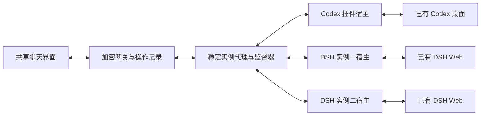

# 独立 Agent 接入插件

网关负责配对、加密、操作记录、同步和文件传输。SDK 定义产品无关的会话接口；产品协议和系统连接器分别位于 `packages/adapter-codex`、`packages/adapter-dsh`。默认附带两款官方插件。每个配置实例有独立 Node 宿主、配置、状态目录与订阅；宿主只连接已有 Agent。

本页描述 Node 网关的插件 SDK 与监督器。纯 Rust Ely 适配器使用独立 Rust 网关，现阶段复用 `instances.json` 配置 DSH 只读实例。 [原生安装与更新](DESKTOP_ADAPTER.md)



## 配置与迁移

旧 `POCKET_BACKENDS_FILE` 中的 DSH 配置自动映射，原有 `codex-local`、DSH ID、配对、草稿、缓存、操作与文件路径保持不变。Codex 的旧环境变量也自动映射到它自己的实例配置。默认客户端仍定位 `codex-local`。

通用配置使用 `POCKET_ADAPTERS_FILE=/absolute/path/instances.json`：

```json
[
  {
    "id": "dsh-one",
    "name": "我的 DSH",
    "plugin": "@agent-remote/adapter-dsh",
    "version": "1.0.2",
    "config": { "url": "http://127.0.0.1:3080", "version": "0.2.1-rc.5" },
    "secrets": { "token": "DSH_ONE_TOKEN" }
  },
  {
    "id": "another-agent",
    "name": "另一个 Agent",
    "plugin": "my-agent-adapter",
    "version": "1.0.0",
    "config": {},
    "secrets": {}
  }
]
```

未列出 `codex-local` 时自动保留默认 Codex。新增/删除实例或修改连接配置后重启网关；已配置实例的插件升级由监督器在线应用。首次绑定取配置中的明确版本，之后以主机私有 registry 的版本绑定为准，修改配置版本不会暗中升级。`codex-local` 保留给原 Codex，不能改指其他产品。

凭据只解析进对应宿主的初始化消息，不写入公开实例描述或插件版本 registry。宿主环境使用允许列表，不继承网关配对密钥、`NODE_OPTIONS` 或其他实例 token。插件是本机受信任代码，进程隔离不等于安全沙箱。

## 安装、升级与回滚

Node 24.15 或更高版本；Codex 连接还需要 Python 3。`npm run build` 编译适配器、网关、前端，并生成默认插件发布包，位于 `dist/adapters`，附 SHA-256 校验文件。已有编译产物时，`npm run package:adapters` 只执行打包。

```sh
npm run adapter -- list
npm run adapter -- install /absolute/path/agent-remote-adapter-dsh-1.0.1.tgz
npm run adapter -- install my-agent-adapter@1.2.3
npm run adapter -- upgrade dsh-one @agent-remote/adapter-dsh@1.1.0
npm run adapter -- rollback dsh-one
```

安装只接受本地 `.tgz`/`.tar.gz` 或明确的 npm 版本，不接受 tag、范围或 Git URL。包先安装到暂存目录，禁用安装脚本，检查入口边界、SDK 版本、模块依赖和工厂导出后才登记。已经存在的同名同版本不能覆盖。默认附带版本无需再次安装。第一批发布以 GitHub Release 的 npm 兼容 tarball 交付；不要求配置公共 npm 账号。

升级命令写入本机私有请求队列。监督器暂停该实例的新写请求，等待在途分发结束；超过等待窗口则延后并保留原宿主。安全交接后替换宿主并恢复订阅，启动失败自动回到旧包。命令返回具体结果；网关离线时明确显示排队及结果文件路径，不宣称已应用。

旧包和版本绑定保留。`rollback` 仅替换插件及其兼容元数据，不回滚网关操作数据库或原生会话。不同 `stateVersion` 的私有状态格式被拒绝，需要开发者提供并明确执行迁移。源码部署仍需显式升级。电脑安装包会在后台下载整包更新，并用同一监督器安全升级其中的官方插件；失败保留旧包。没有手机插件市场。

## IPC 与恢复边界

宿主通过 `vscode-jsonrpc` 的标准流传输和固定方法白名单传递 SDK 请求、结果及归一化事件。Execa 管理启动、超时与协作式退出；独立的 Node IPC 通道只用于 Execa 的取消通知。产品日志写入 stderr，避免破坏 RPC 帧。查询异步，订阅以标识管理；函数与 EventEmitter 不跨进程。界面读取代理缓存的状态和快照。附件源仍经原有授权及分块加密通道，浏览器得不到上游地址或凭据。

每个宿主连接有独立的 JSON-RPC 请求生命周期；进程代次同时校验回复和事件。旧连接先释放，等待旧宿主退出后才启动新宿主；正常退出等待适配器的异步清理，卡死时由 Execa 强制结束辅助宿主。宿主崩溃/心跳停止时，仅对应实例暂时不可用；重新连接后重建订阅与快照。已分发的写操作返回“结果待确认”，不自动重发创建、发送或审批。网关已有的持久操作去重和启动恢复继续适用。实例 SDK 不兼容或缺少安装包不会停用其他实例。

权限、预设、创建规则、计划模式、模型与工具菜单从目录/能力声明读取。第三个插件可使用现有公共聊天能力而不改前端。超出现有公共能力的新交互仍需扩展 SDK 与共享组件；不加载浏览器插件 JS，不转发任意上游 RPC。存储适配器继续使用原有独立契约。

## 验证记录（2026-11-06）

- 完整自动回归 215 项通过；真实宿主测试覆盖三实例同 ID、崩溃、挂起、订阅恢复、迟到代次、未知写结果、重复点击、升级等待/回退、私有状态拒绝迁移、配置迁移及监督器应用。
- SDK、Codex、DSH 的 tarball 在仓库外、空缓存、离线条件下独立安装，模块和 SDK 声明均可加载；另测无 npm CLI 安装、禁用生命周期脚本、编译版宿主、带空格及中文的路径、异步退出清理。
- 第三个测试插件从仓库外发布包加载，使用同一个已构建前端完成加密聊天、刷新恢复和能力菜单；未修改核心产品分支、未重新构建前端。
- 真实 Linux Codex 与两个独立 DSH 宿主同时连接；测试会话历史、权限、模型及快照同步通过。杀死一个 DSH 宿主后自动恢复，另一个保持连接。此轮未向真实会话发送测试消息或反馈，也未启动/关闭原生 Agent。
- 手机视口权限菜单、计划/目标/反馈/导出入口，以及现有配对、草稿、审批、计划卡片、刷新恢复和 320–1280 像素布局回归通过。Android/iOS 真机、macOS/Windows 真桌面仍需另行验收；三系统 CI 的宿主与 Socket/Pipe 契约测试独立记录。

## 可复用的跨平台基础设施

- [Execa](https://github.com/sindresorhus/execa) 管理宿主进程；[vscode-jsonrpc](https://github.com/microsoft/vscode-languageserver-node/tree/main/jsonrpc) 负责协议帧、请求编号、响应匹配及错误。业务层只保留实例、订阅、心跳恢复、写操作交接和结果不确定语义。
- [Arborist](https://github.com/npm/cli/tree/latest/workspaces/arborist) 负责插件安装和依赖解析；[pacote](https://github.com/npm/pacote) 负责 npm 包生成、提取及完整性校验。安装无需搜索本机 npm CLI，不执行包生命周期脚本。
- 两款产品插件分别提交独立 `package-lock.json`。构建先在仓库外安装锁定依赖，再用 npm 的 `bundleDependencies` 生成自包含 tarball。官方客户端路径使用 JavaScript 实现，构建时省略可选的原生加速依赖，三系统 CI 安装同一份 Linux 构建包验证可移植性。网关启动时仅离线解包，不扫描或复制仓库依赖树。发布构建要求锁文件保持不变；更新依赖使用 `node scripts/package-adapters.mjs --update-locks` 并审查锁文件变化。
- [env-paths](https://github.com/sindresorhus/env-paths) 提供系统目录；兼容映射保留 Linux 的 XDG state、macOS Application Support、Windows 原有应用根目录，不移动既有配对或会话文件。
- [rimraf](https://github.com/isaacs/rimraf) 的平台实现负责暂存包和测试目录清理，包含 Windows 文件占用重试。先等待进程退出，再移除文件。
- 本机 Socket/Pipe 的对端身份、Windows 私有 ACL 等原生安全语义仍位于已有平台连接层；通用插件库不替代这些校验，也不负责原生聊天的幂等性。

## 构建、测试与发布职责

- `npm test`：运行 210 项普通回归，不编译、不生成发布包、不隐式安装依赖。
- `npm run test:adapters`：只运行宿主与监督器专项测试。
- `npm run build:adapters`、`build:server`、`build:web`：分别编译对应部分，均不重复触发其他构建。
- `npm run build`：生产构建入口，依次编译并打包一次，产物可以直接部署。
- `npm run test:packages`：对已构建发布包做 5 项独立安装契约检查；它不生成待测产物。
- CI 只在 Linux 构建一次。Linux 运行完整普通回归，macOS/Windows 运行平台与宿主契约；三系统分别验证同一份发布包和编译版宿主，均不重建。
- 标签发布要求同一个提交已有成功的三系统 CI，直接下载该次验证的产物并检查 SHA-256，再发布 GitHub Release；发布阶段不重新编译或安装依赖。

Windows 的空缓存安装涉及上万份依赖文件，明显慢于普通单元测试。三个发布包分别使用独立临时目录、空缓存和计时边界；日志分别记录安装、宿主加载及清理耗时。普通测试不执行这些发布验收，发布时仍完整保留。

业务测试通过已有 `PlatformRuntime` 注入临时目录实现，不反复启动系统权限工具。原生集成测试仍通过 `Store` 默认运行时检查真实目录/数据库 ACL 和 Socket/Pipe 身份。Windows 集成测试限制为单个文件 worker，避免多个测试同时启动 PowerShell 耗尽 CI 资源；宿主并发、隔离与恢复仍在各专项用例内真实验证。
