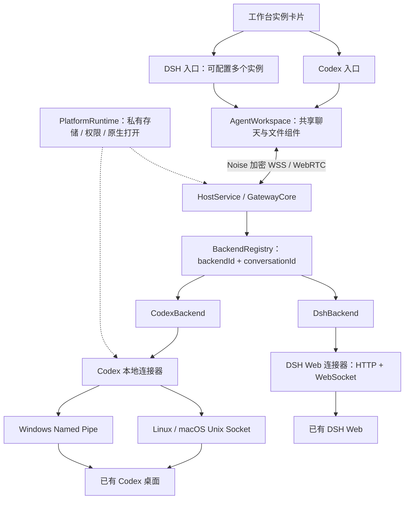

> 接入实现现已迁入独立插件包；安装、配置、升级/回滚和进程隔离以 [独立 Agent 接入插件](ADAPTER_PLUGINS.md) 为准。下文保留原生产品能力与旧配置兼容说明。

# 通用遥控后端与兼容配置

本次实现使用内置 `CodexBackend`、`DshBackend` 和 `BackendRegistry`。产品适配器负责历史、目录、原生控制、附件与操作结果；网关负责设备认证、去重、同步与加密文件传输。连接与查看不会启动 Agent。用户主动新建、发送、追加等操作交由已有产品执行。



## 实例配置

默认实例固定为 `codex-local`。旧客户端省略 `backendId` 时始终使用它。即使 Codex 离线也不会自动转发到 DSH。

在主机的私有配置目录建立 `backends.json`（不要提交真实地址或凭据）：

```json
[
  {
    "id": "dsh-one",
    "name": "DSH 工作实例",
    "type": "dsh",
    "url": "http://127.0.0.1:3000/",
    "tokenEnv": "DSH_ONE_TOKEN",
    "version": "0.2.1-rc.5"
  },
  {
    "id": "dsh-two",
    "name": "DSH 第二实例",
    "type": "dsh",
    "url": "http://127.0.0.1:3001/",
    "tokenEnv": "DSH_TWO_TOKEN",
    "version": "0.2.1-rc.5"
  }
]
```

主机环境设置 `POCKET_BACKENDS_FILE` 为该文件的绝对路径，并设置 `DSH_ONE_TOKEN`、`DSH_TWO_TOKEN` 为各个**已有 Web 实例的访问 token**。这不是模型 API key。`version` 是部署者记录的产品版本，服务目前没有在此连接握手中返回产品版本；不能把这个字段当成自动探测结果，也不以它作为控制开关。

地址必须显式配置；远端部署应使用 HTTPS，并由 DSH 自身配置允许的 Host/Origin。网关不改变 DSH 的信任策略。不读取 DSH 凭据文件，不导入 DSH 的启动入口。凭据或地址更改后重启网关以载入配置，原 Agent 保持运行。单个实例离线或缺少访问 token 不阻止其他实例连接。

连接器调用 `/connect?token=…&interactions=answer`，只接受同源 mux 跳转。HTTP 和 WebSocket 使用同一 API Cookie。连接结束后丢弃 cookie、审批关联和文件 receipt，再重新认证；不重发未知结果的控制操作。

DSH Web 重启会轮换启动 token；此时需从新的 Web 启动链接更新主机私有环境，再重启网关。已有网页 Cookie 和旧 token 不能代替新凭据。网关不启动、停止或重启 DSH。

产品版本及参考档案只用于诊断日志。版本变化或版本元数据缺失不关闭控制、不弹验证提示；连接器继续校验对端身份，适配器按实际握手、事件格式、会话同步及原生接口结果判断能力。明确的协议错误只影响对应连接、会话或操作，不会把其他实例一起停用。

## 原生能力

- DSH 的列表、分页历史、创建、prompt（queue / steer）、cancel、modelCatalog/selectModel、workspace/follow、skills/list 使用 `0.2.1-rc.5` 生成的接口定义；只加载客户端模块、协议定义和消息组装工具。工作区目录读取 `workspace/follow` 的完整 baseline 后释放订阅，上游没有 `workspace/list` RPC。
- 根据原生 `source.kind` 区分用户输入与注入上下文。运行环境、技能目录等上下文保留在折叠活动详情中，不展开成用户聊天气泡。
- `session/follow` 的 durable seq 与手机同步 revision 分开。重复 durable 事件忽略，序号或流块出现缺口则重新获取原生 snapshot。流式文本使用原生 assembler，持久消息到达后替换临时展示。控制投影按各键的原生水位合并，迟到基线不会覆盖较新模型、队列或问题；换连接后重置这些水位。
- 审批只映射 DSH 的单次允许、拒绝、取消。没有伪造“整会话允许”。普通问题通过事件结果返回；限时问题在订阅会话时附加原生等待流，取消或退出时释放；已继续的问题通过原生 `userQuestions/answer` 返回。未知交互和无人订阅的交互调用 `next` 交还其他原生客户端；退出最后一个订阅时释放未回答的交互。
- 发送图片使用 DSH 原生 image 内容和原生图片限制；普通文件先上传取得 session receipt，再发送。图片下载使用 `session/attachment`。本遥控器上传的普通文件可从经原生引用确认的私有副本下载；原生消息引用的路径可经 `/api/file` 授权下载，保留 DSH 的大小限制。
- **DSH 该版本的普通文件引用只有内容 ID，没有公开的按引用下载接口。** 对于在其他客户端上传且没有原生路径引用的历史普通文件，本遥控器能显示引用，但无法下载；不会猜测 DSH 私有存储位置。图片和本遥控器上传的文件不受这一限制。
- DSH 的 cancel 作用于当前会话，原接口没有条件 turn 参数。适配器检查最近同步的预期回合，但上游仍存在检查后回合切换的竞态。模型与队列也按原生接口执行，不能宣称拥有上游未提供的原子条件更新。

## 实例隔离与迁移

`backends.list` 返回公开名称、产品、连接状态、适配档案及带原因的能力。RPC、watch、unwatch 和文件请求增加可选 `backendId`。浏览器不获得上游地址、token、cookie，也没有任意 RPC 转发入口。

- 操作表增量迁移到 `(backend_id, id)` 联合主键；旧操作归 `codex-local`，原配对及设备身份保留。
- 每个实例有独立的 Operations、SyncJournal、上传和文件授权服务。其他实例不能使用本实例的 file ID 或 operation ID。
- Codex 原上传目录、缓存键、草稿键和待确认操作键继续使用。新增实例使用独立命名空间；不把旧缓存迁给 DSH。
- 原生会话 ID 为不含路径分隔符的 opaque string；网关请求、设备会话和文件 ID 仍为 UUID。
- 已分发请求在主机重启后标为“结果待确认”，没有自动重新创建或重新发送机制。创建已成功但后续配置或首条消息失败时保留已知会话 ID，可从操作记录进入核对。

## Codex 系统连接

以下可选环境变量只在主机侧读取：

| 变量                      | 含义                                                               |
| ------------------------- | ------------------------------------------------------------------ |
| `CODEX_HOME`              | 原桌面状态目录                                                     |
| `POCKET_CODEX_ROOT`       | 安装根目录；macOS 为 `.app` 目录                                   |
| `POCKET_CODEX_EXECUTABLE` | 实际对端可执行文件的完整路径                                       |
| `POCKET_CODEX_SOCKET`     | Unix Socket 或 `\\.\pipe\codex-ipc` 的显式覆盖                     |
| `POCKET_CODEX_APP_TOOLS`  | 显式应用工具 Socket / Pipe；存在多个候选时必须选择                 |
| `POCKET_PYTHON`           | Python 3 可执行程序；Windows 默认 `python`，其他系统默认 `python3` |
| `POCKET_STATE_DIR`        | 网关私有状态目录                                                   |

Linux 默认 `/usr/lib/chatgpt`；macOS 在常见 Applications 目录发现安装；Windows 从已运行的 Codex / ChatGPT 进程路径发现，歧义时拒绝自动选择。Windows 应用工具管道尚无经实机确认的自动发现档案，需显式配置。

Python 只做校验和字节转发：Linux `SO_PEERCRED` + `/proc/PID/exe`；macOS `getpeereid` + `LOCAL_PEERPID` + `proc_pidpath`；Windows `GetNamedPipeServerProcessId` + 进程 token SID + `QueryFullProcessImageNameW`。Windows 客户端采用 identification-only SQOS，避免命名管道服务端模拟客户端。POSIX 拒绝不安全的目录、socket 权限和任意符号链接；长路径只接受与预期原目录相符的 Codex 短路径别名。

私有目录默认 Linux XDG state、macOS Application Support、Windows LocalAppData。POSIX 使用 owner/mode 校验；Windows 检查 owner SID 并设独立 ACL，仅允许当前用户和 SYSTEM。

## 兼容矩阵与验证边界

| 项目                                 | 代码/契约状态                         | 本次环境实际验证                                             |
| ------------------------------------ | ------------------------------------- | ------------------------------------------------------------ |
| Linux Codex follower `26.1029.61003` | 沿用已验证协议档案                    | Linux 自动回归、真实 Unix Socket 测试进程                    |
| macOS Codex Socket                   | 原生身份校验及路径实现，实验性        | 本机无法实测；三系统 CI 已配置，未在本次本地运行 macOS job   |
| Windows Codex Named Pipe             | PID、SID、exe 校验及 ACL 实现，实验性 | 本机无法实测；三系统 CI 已配置，未在本次本地运行 Windows job |
| DSH Web `0.2.1-rc.5`                 | HTTP/WS、会话、交互和文件契约，实验性 | 真实 Web 聊天、控制与文件往返；交互保留契约验证边界          |
| 其他 Codex / DSH 产品版本            | 沿用适配器，按实际协议检查            | 不因产品版本变化关闭控制或提示验证状态                       |

macOS / Windows 的未加载 Codex 聊天不会通过未经验证的深链接启动应用；在原桌面打开后可使用已同步的 follower 能力。连接器基础、协议契约通过和真实桌面验收是三种不同结论。

真实产品验收应单独检查：原界面与手机共同操作、模型与审批策略差异、上游重启/更新、历史大文件、真实手机后台恢复。自动化只启动测试 Socket/Pipe、模拟 Web 服务和测试浏览器，不启动真实 Agent。

首次架构交付完成 34 个测试文件、188 项自动测试，类型检查、构建及公开内容扫描通过。随后真实 DSH 接入与开机恢复修复完成 35 个测试文件、192 项自动测试及类型检查，增加离线进程存活、版本变化/缺失、工作区原生流和上下文呈现回归。

浏览器使用 390×844 与 1440×900 视口，检查页面身份、非空渲染、错误遮罩、控制台和布局截图。多实例回归覆盖同 ID 草稿隔离、刷新与模块切换、空 DSH 实例创建第一条会话；原 Codex 回归覆盖配对、WebRTC、计划审批和缓存管理。另有连接回归覆盖直连仍在线时中继断开、全部通道断开后的控制禁用、自动恢复及公网版本检查，确认草稿与配对保留。三套浏览器回归均通过，未出现未捕获错误。这些夹具结果不等同于 Android/iOS 真机或真实 DSH 的验收。

2026-11-06 另对已运行的真实 DSH Web `0.2.1-rc.5` 完成认证、会话列表、历史和实时订阅；独立测试会话完成新建、回复、模型切换与恢复、普通文件上传下载、队列加入/移除、追加和中断。原生提问工具生成的问题成功映射为卡片，回答后卡片撤下、原生任务继续完成。公网移动视口通过加密链路发送附件和消息，刷新后恢复同一原生历史；另打开 DSH 原生网页，确认同一会话及回复存在。真实命令审批、两端同时回答竞态、跨重启凭据更新及 Android/iOS 真机尚未完成本轮验收，仍保留对应契约测试边界。Codex `26.1103.31037` 完成真实握手和活动会话同步，控制由运行状态决定；未向用户现有会话注入测试消息。

## 验证命令

```sh
npm run typecheck
npm test
npm run build
npm run doctor -- --backend dsh-one
npx vitest run test/platform-connectors.test.ts
```

三系统 CI 位于 `.github/workflows/compatibility.yml`。UI 夹具构建需清空公开 CDN 配置，避免加载部署中的旧资源：

```sh
POCKET_ENV_FILE=/dev/null POCKET_ASSET_BASE= npx vite build --outDir ../../.implementation/web
TEST_BIND=<本机Tailscale地址> TEST_WEB_ROOT=.implementation/web TEST_DSH=1 TEST_DIRECT=0 node --import tsx scripts/backend-browser-smoke.ts
TEST_BIND=<本机Tailscale地址> TEST_WEB_ROOT=.implementation/web node --import tsx scripts/connection-browser-smoke.ts
```

该 UI 脚本输出临时目录中的截图与检查结果，退出后关闭模拟服务。它使用现有 Playwright；本会话未提供 Browser 插件。

参考：[OpenCode client-only SDK](https://opencode.ai/docs/sdk/#client-only)、[VS Code remote architecture](https://code.visualstudio.com/api/advanced-topics/remote-extensions#architecture-and-extension-kinds)、[ACP 能力协商](https://agentclientprotocol.com/protocol/v1/initialization)、[DSH Connection](https://github.com/deepseek-ai/deepseek-harness/blob/master/packages/client/connection/README.md)、[DSH Session Controller](https://github.com/deepseek-ai/deepseek-harness/blob/master/packages/api/session-controller/README.md)。实现契约以固定 npm 版本为准，不以持续变化的 master 代替测试。

## 会话控制入口（2026-11-06）

输入区直接显示当前权限，点击即可展开选项菜单；点击外部或按 Esc 收起，没有整页遮罩。计划、预设、目标、文件、反馈与导出在独立“工具”菜单中。Codex 支持只读、工作区内修改、完全访问；自定义权限只展示，不改写全局配置。权限操作检查原生设置指纹，并等待权限档案、沙箱和审批策略全部确认。正在执行的回合遵守原生生效时机。新建 Codex 首轮沿用原生创建权限，不提供无效的首轮权限选择器。

DSH 新建可选择工作区、Agent 预设、权限和计划模式；首条消息在设置完成后提交。已有会话的 Agent 预设在首轮开始后锁定。会话控制面板提供计划、目标创建/修改/暂停/继续/完成/清除、压缩、反馈、工作区文件查询和 ZIP 日志导出；模型仍使用独立模型面板，手机附件沿用加密上传通道。输入内置斜杠命令会进入会话控制入口，不把该命令交给模型；已选技能保持原语义。

所有控制使用固定加密 RPC 路由和适配器内部的生成协议类型。反馈必须显式提交，可能按 DSH 配置附带会话日志；自动测试仅使用模拟接收端。ZIP 由网关携带 API 身份取得，限制 256 MiB，并通过既有分块加密通道传输。浏览器不能访问上游 Cookie 或任意上游 RPC。

请求 UUID 沿用网关持久去重。原生命令返回的 commandId 与结果存入实例私有 commands 目录；结果未知时不自动重放。创建中途失败保留原生会话 ID，新会话草稿按主机/实例/锚点保存，并提供进入已创建会话的入口。

本次本机实测包括 DSH 权限/计划切换、首轮权限设置先于发送、目标创建/暂停/清除、预设锁定和原生 ZIP；Codex 独立测试会话验证了权限档案、沙箱及审批策略同步。反馈只做模拟测试。Android/iOS 物理设备、macOS/Windows 原生桌面，以及所有原生交互的双端竞态仍需独立实机验收，不能以桌面浏览器测试替代。
